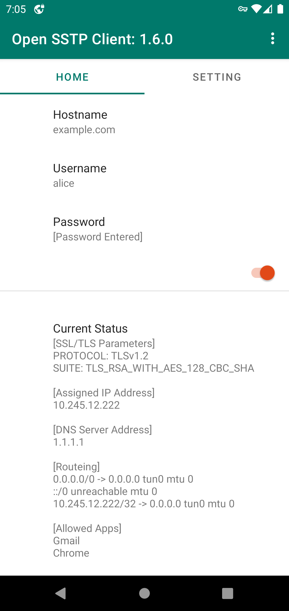
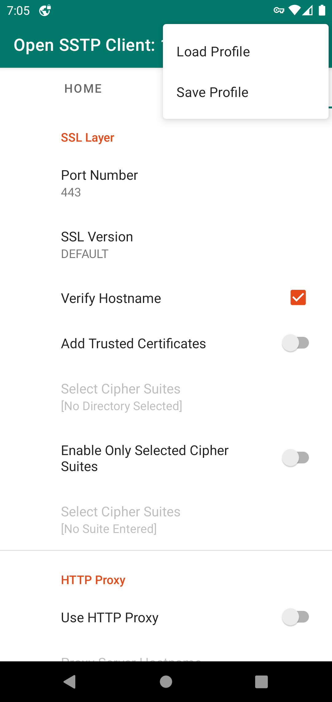
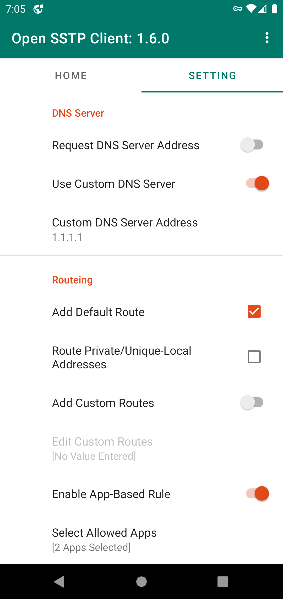
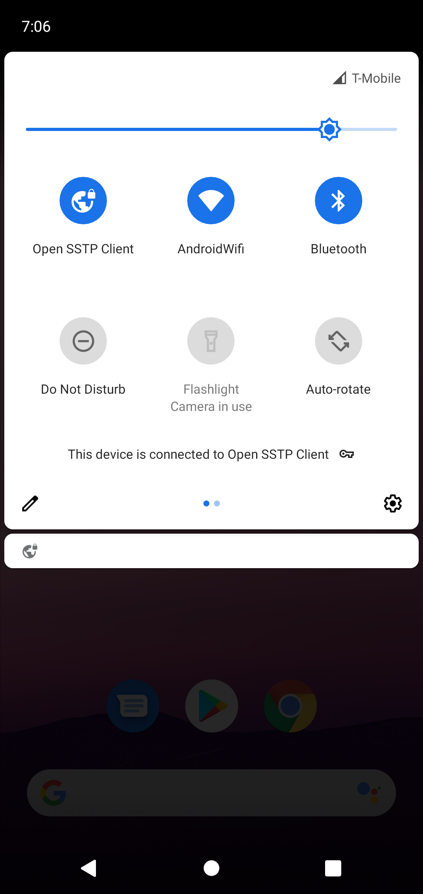

# Open SSTP Client for Android 
This is an open-sourced Secure Socket Tunneling Protocol (MS-SSTP) client for Android, developed for accessing to
[VPN Azure Cloud](https://www.vpnazure.net/) (or [SoftEther VPN Server](https://www.softether.org/)).
So no test with other servers is done. Its behavior may be still unstable.

## Installation
You can download and install the latest version via [Google Play](https://play.google.com/store/apps/details?id=kittoku.osc).
Some of previous versions are released as apk file on [the releases page](https://github.com/kittoku/Open-SSTP-Client/releases).

## Usage
Enter `Host`, `Username` and `Password` preferences and turn the switch on. If a key icon gets to show on
the right side of the status bar, establishing a VPN connection has been succeeded. To disconnect
the connection, turn the switch off in the home tab or tap the notification. You can save/load the
profile from the upper-right option menu.
<br>






## Setting tab
Some settings to be noted are written below:

### Specify Trusted Certificates (SSL Layer)
If you choose a certain directory, the client uses ONLY certificates in the directory, but the default
certificate store. I made this option for debugging.

This preference is displayed as `Add Trusted Certificates` in v1.7.0 or older.

### PPP Network Protocol
You can choose what network protocol PPP layer tries enabling. Remember, IPv6 option just gives the device
a link local address, never guarantees that you can communicate perfectly with IPv6 protocol.

### Custom DNS Server Address
You can specify DNS server to use in this option. Packets associated with this address is routed to
the VPN tunnel. If you specify a IPv4(v6) address and disable IPv4(v6) network,
domain names possibly cannot be resolved.

### Enable App-Based Rule
With `Select Allowed/Disallowed Apps` option, you can specify the apps which can/cannot use the VPN tunnel.
Even allowed apps cannot use the VPN tunnel if their routes are not on the routing table.
So when you use this option, enabling `Add Default Route` option is recommended.


## Notice
* `Host` preference can also contain IP address, but cannot include a port number. You can configure it in
the setting tab.

* Your device needs to install a self-signed certificate and
 disable `Verify Hostname` option to access to a server using it

* A server must enable DHCP

* Only **PAP** and **MS-CHAPv2** authentication protocols can be enabled. No EAP.

## Debugging
It is almost impossible that I can debug a problem caused in any environments but my own. In a networking
app, there are many possible reasons to cause the problem and I cannot identify the real one unless the
problem can be reproduced in my environment.

So it is strongly encouraged that you should debug by yourself. With `Select Cipher Suites` option, this client tries
to use `TLS_RSA_WITH_AES_128_CBC_SHA` or `TLS_RSA_WITH_AES_256_CBC_SHA` as a cipher suite so that you
can decrypt and investigate packets with software like WireShark. I think there can be a similar app for
Android. Don't forget the great software, Android Studio and its emulator (v^ー°)

I don't have Windows Server OS. So I don't officially support accessing to it, but there is a
 successful case. See [this issue](https://github.com/kittoku/Open-SSTP-Client/issues/8#issuecomment-590241322).

## License
Licensed under MIT. Be sure you use this software at your own risk.

## Configurations and appearance

Use **Configurations** in the menu to add, load, edit, delete, and test saved
profiles. New profiles copy the current advanced settings; editing changes the
name, endpoint and credentials while retaining the other settings. Load a profile
before connecting. The connection test attempts one TCP connection to the
specified host and port and reports elapsed time, not ICMP ping, SSTP
compatibility, or VPN authentication. Only test servers you are authorized to
contact. Credentials in saved and exported profiles are stored as plaintext;
protect the device and exported files accordingly.

Use **Theme** in the menu to choose system default, light, or dark mode.

## Builds and releases

The Android workflow tests and builds a debug APK on pull requests and pushes to
main. To publish a signed release, configure repository Actions secrets
`ANDROID_KEYSTORE_BASE64` (base64-encoded keystore), `ANDROID_KEYSTORE_PASSWORD`,
`ANDROID_KEY_ALIAS`, and `ANDROID_KEY_PASSWORD`, then push a `v*` tag. The
workflow signs and verifies the release APK and attaches it to a GitHub Release.
Keep the same signing key for future updates. No release is published until a
tag is pushed and the secrets are configured.

This repository incorporates upstream Open-SSTP-Client source at commit `5f97511c3afff7dcf76b763882e0e29207ad1a36`; see LICENSE and CONTRIBUTORS.md.

### Importing an endpoint list

In **Configurations**, choose **Import endpoint list** and select a UTF-8 text
file on the device. It accepts one hostname, IP address, `host:port`, bracketed
IPv6 address and port, or HTTP(S) URL per line. An optional `country |` label
and `#` comments are ignored. Addresses without a port use SSTP port 443;
network ranges are not accepted. Files are limited to 1 MiB and 200 unique
endpoints. Existing configurations with the same endpoint name are not
replaced. Imported profiles use default settings and have no credentials, so
edit them before use as necessary.

For example, download the two lists separately to a computer or device, then
select each text file in the app:

```sh
curl -fL 'https://raw.githubusercontent.com/F0rc3Run/F0rc3Run/refs/heads/main/sstp-configs/sstp_with_country.txt' -o sstp-with-country.txt
curl -fL 'https://raw.githubusercontent.com/Delta-Kronecker/Vpn-Gate/refs/heads/main/sstp_hosts.txt' -o sstp-hosts.txt
```

Importing a file does not contact any listed hosts. To compare online lists,
open **Configurations** on the home screen, choose **Find fastest from sources**,
and tap **Compare sources**. The two lists above are preconfigured; you can add,
edit, or remove HTTPS source URLs. After confirmation, the app downloads each
list (maximum 1 MiB per source), deduplicates at most 1,000 endpoints, and
attempts a TCP connection to each advertised port with bounded concurrency.
Successful connections are sorted by elapsed time. Source errors are reported;
if the combined endpoint limit is exceeded the comparison stops rather than
silently ranking a subset. Choose a result to save or apply it as primary. New
entries use default settings and no credentials; edit them before connecting.

This is a TCP connect time (including name resolution), not nmap's ICMP latency,
and it does not establish that SSTP or credentials work. Results depend on your
network and are not a throughput measurement. Only test endpoints you are
authorized to contact. The VPN must be disconnected before applying a profile.

### Troubleshooting release signing

`ANDROID_KEYSTORE_BASE64` must contain the base64 encoding of the **binary**
JKS or PKCS#12 keystore containing your Android signing private key, not a
password, certificate, PEM file, path, or an already-base64-encoded file. For
example, on Linux, `base64 -w 0 /path/to/release.keystore` produces the value
to put in the repository's Actions secret. On macOS, use
`base64 -i /path/to/release.keystore | tr -d '\n'`. Encode the original binary
file exactly once. Never commit the keystore or put secret values in logs or
chat. Keep a secure backup of the keystore.

Before configuring Actions, verify the original file and alias locally with
`keytool -list -v -keystore /path/to/release.keystore -alias YOUR_ALIAS`.
Enter the store password interactively; the alias must be a `PrivateKeyEntry`.
Set the other secrets to the matching store password, alias and private-key
password. PKCS#12 typically uses the same password for the store and key.
`Tag number over 30 is not supported` often indicates that the decoded data is
not a valid keystore (for example, it was encoded twice); a wrong password or
alias can also prevent signing. Don't replace an existing signing key for an
already-installed release: Android updates require the original key.

The workflow in a tag is fixed to that tagged commit. After fixing secrets,
rerun the failed job for that tag; to include later code fixes, create a new
`v*` tag pointing at the updated commit instead.
